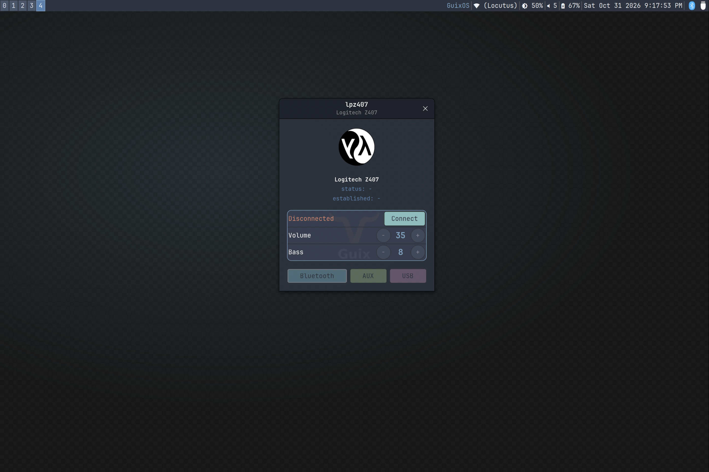
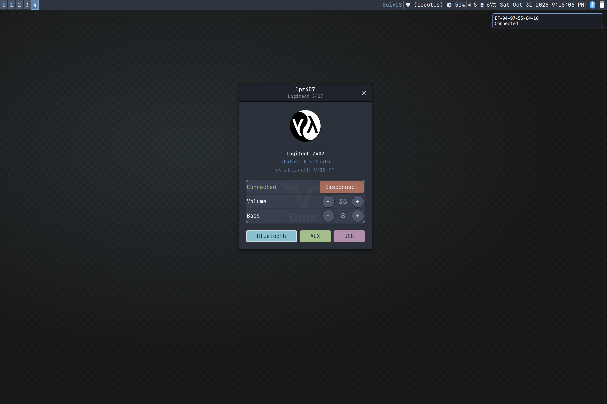

# lpz407

A native, extensible, GTK4/libadwaita control app for the Logitech Z407
Bluetooth speaker, written in Common Lisp (SBCL). It sets volume, bass and
input, and remembers where you left them.

<p align="center">
  
</p>

<p align="center">
  
</p>

## Install

Pair the Z407 with your computer first, so BlueZ knows it.

Get the system libraries and SBCL with Guix:

```sh
guix shell -m manifest.scm
export LD_LIBRARY_PATH="$GUIX_ENVIRONMENT/lib:$LD_LIBRARY_PATH"
```

Get the Lisp libraries with [ocicl](https://github.com/ocicl/ocicl). Upstream
`cl-gtk4` is currently broken, so vendor commit `b3e69da` of it into
`./ocicl/`.

Then, in SBCL:

```lisp
(asdf:load-system :lpz407)   ; load
(lpz407:main)                ; run; press Connect in the window
(asdf:test-system :lpz407)   ; test
```

### Executable

```lisp
(asdf:make :lpz407)          ; writes ./lpz407
```

Run `./lpz407` from the same Guix shell, with `LD_LIBRARY_PATH` set as above.
The logo is found next to the executable (`data/graphics/`), in its
`../share/lpz407/graphics/`, or in the source tree it was built from; set
`:logo` in the config to use another.

## Config

Optional. `~/.config/lpz407/config.sexp` holds one plist. It is read as data,
never evaluated, and a missing file, bad value or unknown key falls back to the
default with a warning.

```lisp
(:theme    (:alpha 0.8
            :accent "#88c0d0"
            :connect "#8fbcbb"
            :font "JetBrains Mono")
 :window   (:width 360 :height 320)
 :controls (:logo nil)
 :labels   (:connect "Connect"))
```

- `:theme` holds the colors, `:alpha`, `:font`, a `:logo` SVG path and a
  `:css` file for extra rules.
- `:window` sets the size.
- `:controls` shows or hides `:logo`, `:info`, `:connection`, `:volume`,
  `:bass` and `:inputs`.
- `:labels` sets the text of the buttons and rows.

Every key and its default is in `*schema*` in `code/base/config.lisp`.
`history.sexp` in the same directory is the app's own file; leave it alone.

## Guix

A Guix package recipe, module `(guixos packages lpz407)`, is in the
[guixos](https://codeberg.org/logoraz/guixos) repository. It installs the
program with a `.desktop` entry, so launchers such as fuzzel list it.

## References

- [logi-z407-reverse-engineering](https://github.com/freundTech/logi-z407-reverse-engineering)
  by freundTech: the Z407 Bluetooth protocol, which `z407-protocol.lisp`
  implements.
- [ocicl](https://github.com/ocicl/ocicl): Common Lisp system manager.
- [cl-gtk4](https://github.com/bohonghuang/cl-gtk4): GTK4 and libadwaita
  bindings.
- [dbus](https://github.com/death/dbus): D-Bus client, used to talk to BlueZ.
- [iolib](https://github.com/sionescu/iolib): event loop behind the D-Bus
  connection.
- [FiveAM](https://github.com/sionescu/fiveam): the test framework.
- [GNU Guix](https://guix.gnu.org/): the system this was developed on, which
  `manifest.scm` targets.

## License

```lisp
(defmacro license-terms (system . plist)
  "See LICENSE for the actual legally-binding, non-parenthesized version."
  (declare (optimize (safety 0))) ; use at your own risk
  `(list :system ',system ,@plist))

(license-terms lpz407
  :type        '(:MIT . "https://spdx.org/licenses/MIT.html")
  :permissions '(:use :copy :modify :merge :publish :distribute
                 :sublicense :sell)
  :conditions  '(:include-copyright-notice
                 :include-license-notice)
  :warranty    nil)
```

↳ [LICENSE](LICENSE)

<p align="center">
  
</p>
